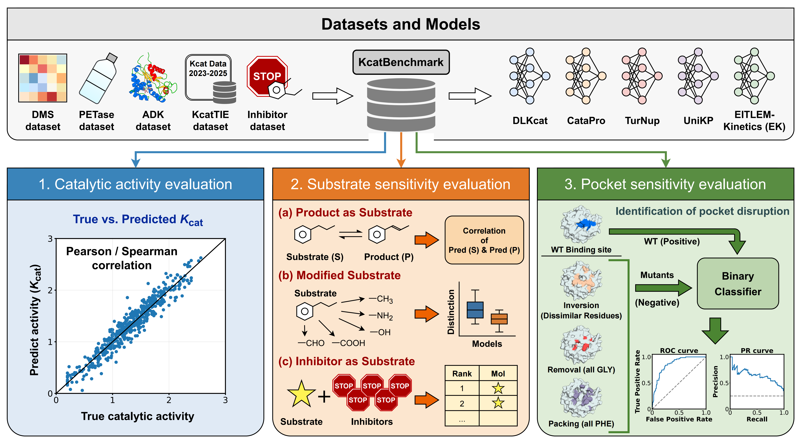

# kcat_benchmark_2025

Benchmarking deep learning $k_{\text{cat}}$ prediction models. This repository hosts the curated datasets and evaluation code for the paper:

**"Deep learning for enzyme $k_{\text{cat}}$ prediction: what works, what doesn't, and why?"**
*Zhang, Z., Wang, Z., Li, D., et al. (2026). [Journal Name], DOI: [To be updated]*



---

## Overview

Deep learning models for turnover number ($k_{\text{cat}}$) prediction are widely reported, yet their practical utility in enzyme engineering remains unclear. We benchmark five state-of-the-art models (DLKcat, UniKP, CataPro, EITLEM-Kinetics (EK) and TurNuP) using multi-dimensional tests that go beyond standard regression metrics. The benchmark probes three questions:

1. **Catalytic activity** — how accurately are absolute $k_{\text{cat}}$ values predicted, and how well are variants ranked?
2. **Substrate sensitivity** — do models respond to substrate chemistry, reaction direction and inhibitor identity?
3. **Pocket sensitivity** — do models respond to designed perturbations of the active-site pocket?

---

## Datasets Overview

All datasets were curated with task-specific protocols. Data files are stored in `/data`.

| Dataset | Source & Description | Key Metrics | File Path |
|---|---|---|---|
| **KcatTIE** | Temporally independent set (2023–2025) curated with zERExtractor | 152 $k_{\text{cat}}$ values from 55 enzymes | `data/KcatTIE/KcatTIE_data.csv` |
| **ADK** | Adenylate kinase orthologs and variants (Muir et al., 2025) | 177 $k_{\text{cat}}$ measurements | `data/ADK/ADK_data.csv` |
| **BglB** | $\beta$-glucosidase WT and single mutants | 557 records (WT + 556 mutants); 386 activity-classification subset; 161 $T_{\text{m}}$-complete | `data/BglB/BglB_data.csv`, `data/BglB/BglB_data_classification.csv` |
| **PETase** | Engineered PET hydrolases (Norton-Baker et al., 2025) | Relative product yield for 214 enzymes (complementary phenotype) | `data/PETase/PETase_data.csv` |
| **DMS** | ProteinGym deep mutational scanning | Fitness for 8 enzyme systems | `data/DMS/DMS_*_data.csv` |
| **Reversible** | Paired forward/reverse reactions with measured $k_{\text{cat}}$ | 57 pairs (114 directional records) | `data/Reversible/Reversible_data.csv` |
| **Modification** | Reaction-center substrate modifications across EC 1–5 | 432 strict modification records (20 subclasses × 5 enzymes) | `data/Modification/Modicication_data.csv` |
| **Inhibitor** | BindingDB/ChEMBL enzyme–substrate–inhibitor triads | 28 targets; 2,656 curated inhibitor records | `data/Inhibitor/Inhibitor_data.csv` |
| **P450** | Curated P450 enzyme–reaction records | 214 records (supplementary regression) | `data/P450/P450_data.csv` |
| **PjxA** | Purified-enzyme validation of model-prioritized mutants | 99 samples (WT + 98 mutants) | `data/PjxA/PjxA_data.csv` |
| **GDH** | Independent purified-enzyme validation system | 47 samples (WT + 46 mutants) | `data/GDH/GDH_data.csv` |

The eight primary benchmark datasets are KcatTIE, ADK, BglB, PETase, DMS, Reversible, Modification and Inhibitor; P450, PjxA and GDH are used for supplementary or experimental validation analyses.

---

## Benchmark Tasks

### 1. Catalytic-activity prediction
Predicted and measured $k_{\text{cat}}$ values are compared using Pearson $R$, Spearman $\rho$ and MAE on KcatTIE, ADK and BglB. PETase product yield and DMS fitness are analyzed as complementary phenotypes, not as direct $k_{\text{cat}}$ measurements.

### 2. Substrate-sensitivity tests
- **Reaction direction:** rank the higher-$k_{\text{cat}}$ direction across 57 reversible-reaction pairs (114 directional records).
- **Reaction-center modification:** compare predictions for parent and reaction-center-modified substrates (432 records) using $\Delta=\log_{10}(k_{\text{cat,modified}})-\log_{10}(k_{\text{cat,parent}})$, parent-ranking success and AUC.
- **Inhibitor discrimination:** rank each authentic substrate against candidate inhibitors in 28 enzyme–substrate–inhibitor triads, including a competitive-like subset.

### 3. Active-site pocket sensitivity
AlphaFold 3 complex structures are used to define active-site pockets (residues within 4 Å of any ligand atom). Three classes of designed variants are generated: glycine substitutions, phenylalanine substitutions and physicochemical-inversion substitutions. Models are evaluated on WT-versus-variant classification (ROC/PR) and, for BglB, on activity classification and $T_{\text{m}}$ stratification.

For BglB, variants with relative activity $>0.5$ of WT were classified as high-activity and $<0.1$ as strongly impaired; intermediate variants were excluded (n = 386). Thermal destabilization was operationally defined as $\Delta T_{\text{m}}\leq-2\ ^\circ\text{C}$ in the $T_{\text{m}}$-complete cohort (n = 161).

---

## Models Benchmarked

| Model | Training data & design | Reported performance | Repository |
|---|---|---|---|
| **DLKcat** | BRENDA + SABIO-RK; 16,838 $k_{\text{cat}}$ records; CNN (sequence) + GNN (substrate) + attention | Test log$_{10}$ RMSE = 1.06, Pearson $r$ = 0.71 | [SysBioChalmers/DLKcat](https://github.com/SysBioChalmers/DLKcat) |
| **UniKP** | BRENDA + SABIO-RK; 15,154 train + 1,684 test records; ProtT5 + SMILES Transformer + Extra Trees | Mean $R^2$ = 0.68, PCC = 0.85 | [Luo-SynBioLab/UniKP](https://github.com/Luo-SynBioLab/UniKP) |
| **CataPro** | BRENDA + SABIO-RK; 27,658 $k_{\text{cat}}$ records; CD-HIT clustering (<40% identity); ProtT5 + MolT5 + RDKit/MACCS | Unbiased CV: PCC = 0.497, Spearman $\rho$ = 0.495 | [zchwang/CataPro](https://github.com/zchwang/CataPro) |
| **EITLEM-Kinetics (EK)** | BRENDA + SABIO-RK; 34,429 records; mutant-focused; ESM-1b + MACCS + iterative transfer learning | Test $R^2$ = 0.746; novel enzyme + substrate $R^2\approx-0.08$ | [XvesS/EITLEM-Kinetics](https://github.com/XvesS/EITLEM-Kinetics) |
| **TurNuP** | BRENDA + UniProt + SABIO-RK; 4,271 WT/natural-reaction records; Transformer + differential reaction fingerprints (DRFP) + XGBoost | Test $R^2$ = 0.44, Pearson $r$ = 0.67 | [AlexanderKroll/kcat_prediction](https://github.com/AlexanderKroll/kcat_prediction) |

All five models were evaluated with their published pretrained weights; no retraining, fine-tuning or hyperparameter optimization was performed on the independent test sets.

---

## Installation & Data Access

Clone the repository:

```bash
git clone https://github.com/zelixirSH/kcat_benchmark_2025.git
```

Data files are in `/data`. Column descriptions and units (for example, $k_{\text{cat}}$ in s⁻¹ and $T_{\text{m}}$ in °C) are given in the file headers.

---

## Experimental Validation

Model-prioritized mutants were expressed, purified and assayed in two systems:

- **PjxA xylanase:** 99 samples (WT + 98 unique single mutants) prioritized by the five models. $k_{\text{cat}}$ was determined with the DNS reducing-sugar assay.
- **GDH (galactitol dehydrogenase):** 47 samples (WT + 46 mutants). $k_{\text{cat}}$ was determined by monitoring NADH production at 340 nm.

---

## License & Citation

### License
The datasets and materials in this repository are released under the [MIT License](LICENSE).

**Requirements:**
- Include the original copyright notice in all copies.
- Retain the license text in all substantial portions.

**Disclaimer:** THE SOFTWARE IS PROVIDED "AS IS", WITHOUT WARRANTY OF ANY KIND. See the full [LICENSE](LICENSE) for details.

### How to Cite

```bibtex
@article{Zhang2026kcat,
  title   = {Deep learning for enzyme k_cat prediction: what works, what doesn't, and why?},
  author  = {Zhang, Zhongyang and Wang, Zhihao and Li, Dejiao and et al.},
  journal = {[Journal Name]},
  volume  = {},
  pages   = {},
  year    = {2026},
  doi     = {[To be updated]}
}
```

**Always cite the original data sources** (e.g., BRENDA, SABIO-RK, ProteinGym, BindingDB, ChEMBL).

---

## Support & Contact

- **Issues:** [GitHub Issues](https://github.com/zelixirSH/kcat_benchmark_2025/issues)
- **Contact:**
  - Zhongyang Zhang: `zhangzhongyang@ynnu.edu.cn`
  - Zhihao Wang: `wangzh336699@gmail.com`

---

## Repository Structure

```
kcat_benchmark_2025/
├── data/          # Curated benchmark datasets
├── images/        # Main-text figures (Fig. 1–6)
├── LICENSE
└── README.md
```
